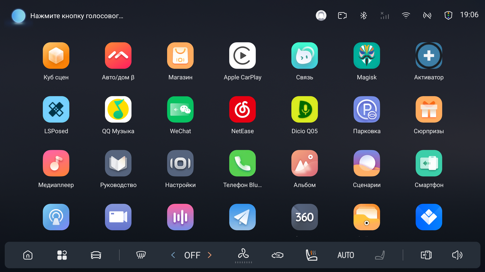

# Changan Qiyuan Q05 LU+ — русификация и доработки

Бесплатный проект для **Changan Qiyuan Q05 Laser Ultra Plus**. Работаем над русским интерфейсом центрального экрана и водительской приборки, навигацией, озвучкой и удобством штатных приложений.

[Таблицы перевода](translations/) · [Релизы GitHub](https://github.com/LuckDMST/q05-ru/releases) · [Сообщить об ошибке](https://github.com/LuckDMST/q05-ru/issues)

## Что уже работает и что ещё в разработке

Состояние на **19 ноября 2026 года**. Проверки на автомобиле относятся к одному LU+ с головным устройством **B216, Android 14, SWC.1371.RB216000004**. В таблице указано, какие функции наблюдали на машине и к какой версии относится результат.

| Модуль | Текущий статус |
| --- | --- |
| [Qiyuan Q05 Russian UI](docs/modules/russian-ui.md) | Перевод ГУ проверен частично. Последний кандидат проверен локально. |
| [Русский интерфейс нативной приборки](docs/modules/native-cluster.md) | Русские подписи и компоновка проверены на отдельных экранах. |
| [Навигация на приборке](docs/modules/cluster-navigation.md) | Показ Яндекса проверен на прежней сборке. Свайп на code52 требует исправления. |
| [Интерфейс и настройки](docs/modules/interface-tweaks.md) | Разделение экрана и скрытие рекомендаций проверены на прежних версиях. |
| [Рабочая область](docs/modules/app-workspace.md) | Установка подтверждена. Поведение новой сборки ждёт проверки. |
| [Русская озвучка](docs/modules/russian-voice.md) | На прежней сборке слышали отдельную русскую реплику. |
| [Русский голосовой ввод (Dicio / Vosk)](docs/modules/dicio-voice-input.md) | Экспериментальный APK установлен, модуль выключен. |
| [Перевод кругового обзора (AVM / Magisk)](docs/modules/avm-magisk.md) | Подмена конфига проверена по хешу. Показ нового текста ещё предстоит проверить. |

## Сопутствующие работы

**Сервис Q05** (`io.github.luckdmst.q05.service`) — отдельная служебная утилита для диагностики и подготовки ГУ. На машине установлен code20. Проверка функций этой сборки и установка модулей из сервиса ещё в работе.

Ведём корпус голосовых фраз и WAV-образцов, карту экранов для проверки перевода и исследования штатных сценариев, связи ГУ с T-Box и телефонным приложением. Отдельно изучили сторонние утилиты, включая «Q05 Энергия».

## Таблицы перевода

В репозитории доступны 34 таблицы TSV. Имя файла соответствует пакету Android. Среди приложений есть настройки автомобиля, климат, системный интерфейс, лаунчер, мультимедиа, телефон и редактор сценариев. [Открыть таблицы](translations/)

В каждой строке пять полей, разделённых табуляцией: полное имя ресурса, индекс элемента массива (`-1` для обычной строки), исходный текст, зарезервированное поле и русский перевод. При редактуре сохраняйте имя ресурса, индекс, исходный текст и параметры форматирования.

При сообщении об ошибке укажите модель и сборку ГУ, версию модуля, путь к экрану и проблемный текст. Если прикладываете скриншот, уберите VIN, имена и данные аккаунтов. [Открыть Issues](https://github.com/LuckDMST/q05-ru/issues)

## Сборки и совместимость

Публичных APK и ZIP в GitHub Releases пока нет. Рабочая версия русификатора ГУ включает базовый словарь оригинального Q05 RU и наши правки в одном APK. У неё свой идентификатор `io.github.luckdmst.qiyuanq05`. При сравнении с оригиналом в LSPosed включайте модули по одному с одинаковым набором целевых приложений.

Пакет нативной приборки и Magisk-модуль AVM относятся к отдельным выпускам. Для каждого нужна своя инструкция и подтверждение совместимости. Обновление через каталог LSPosed пока не проверено. [Следить за выпусками](https://github.com/LuckDMST/q05-ru/releases)

## Благодарности

Исходный модуль **Q05 RU** разработал **PavelAravin**. **LuckDMST** развивает адресный перевод штатных приложений, исправляет подписи и разметку, ведёт проверку на автомобиле и готовит отдельные модули. [Оригинальный проект на GitVerse](https://gitverse.ru/PavelAravin/q05ru)
