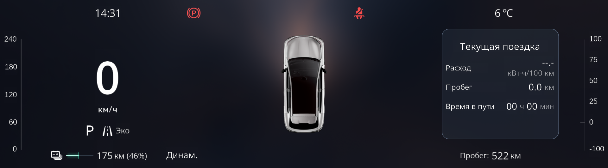

# Русский интерфейс нативной приборки

[Все модули](../../README.md)

Русские подписи и предупреждения водительской панели, а также правки разметки. Пакет ресурсов применяется к нативному Linux HMI приборки.

Состояние на 19 ноября 2026 года. Проверки проводились на Qiyuan Q05 LU+ с ГУ B216.

## Что проверили на машине

Готовая разработка. Активен архив Linux HMI `2026-11-16_14`. Проверены перевод, предупреждения и состояния приборки, включая запас хода и заряд, давление в шинах и страницы самопроверки.

Кадр снят 16 ноября 2026 года на архиве `2026-11-16_14`. Экран показывает остановленный автомобиль и нулевые показатели текущей поездки.

## Что в работе

Для публикации подготовить отдельный пакет ресурсов Linux HMI и инструкцию установки. Наружные голосовые реплики зарядки относятся к отдельной работе и не входят в этот модуль.

## Связанная работа: наружная реплика зарядки

Владелец услышал «Зарядка началась» снаружи автомобиля. Это отдельная ветка Linux. Другие события зарядки и полный набор наружных реплик ещё проверяются.

## Скачать

[Предварительный выпуск архива B216 `_14`](https://github.com/LuckDMST/qiyuan-q05-mods/releases/tag/cluster-native-ru-2026-11-16_14) · [Все релизы проекта](https://github.com/LuckDMST/qiyuan-q05-mods/releases)
