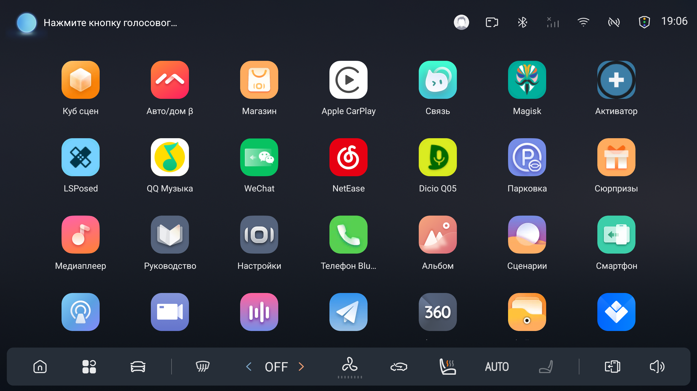

# Qiyuan Q05 Russian UI

[Все модули](../../README.md)

Русификация штатных приложений на центральном экране. Модуль LSPosed включает базовый словарь Q05 RU и адресные правки для настроек автомобиля, климата, шторки, мультимедиа, телефона, камеры и редактора сценариев.

Идентификатор пакета: `io.github.luckdmst.qiyuanq05`.

Состояние на 19 ноября 2026 года. Проверки проводились на Qiyuan Q05 LU+ с ГУ B216.

## Что проверили на машине

На предыдущих версиях видели русский текст в настройках автомобиля и проверяли отдельные подписи шторки, сидений, регистратора и Bluetooth. Подтверждена установка code271.

## Что в работе

Кандидат 2.68-preview (code278) собран и проверен локально. Его новые подписи сценариев ждут проверки на экране. Предстоит пройти все меню и состояния, проверить переносы, форматирование и загрузку внешних таблиц на ГУ.

## Таблицы и пример перевода

[Таблицы TSV по приложениям](../../translations/)

## Сборки

Публичная сборка пока не опубликована. [Релизы проекта](https://github.com/LuckDMST/qiyuan-q05-mods/releases)
